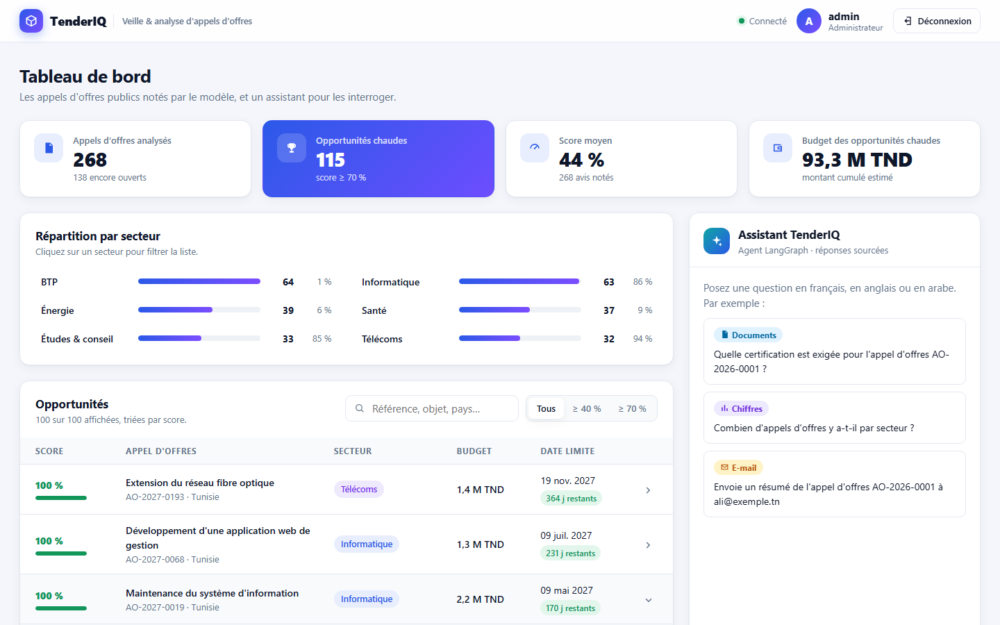
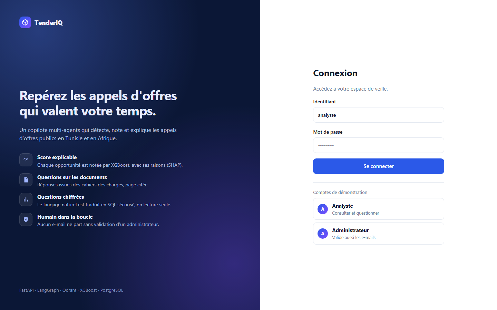
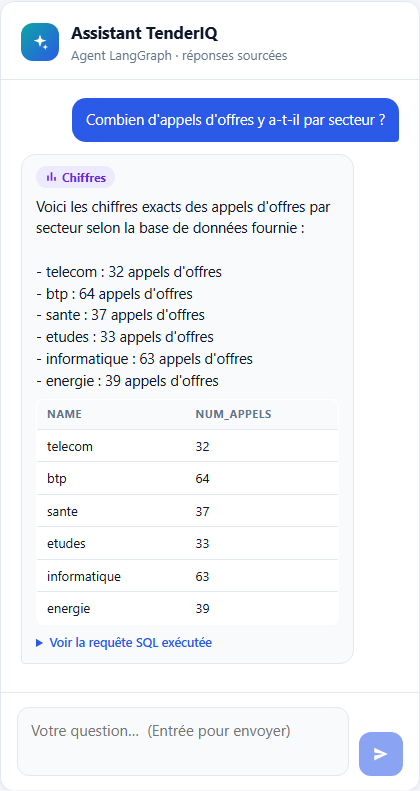
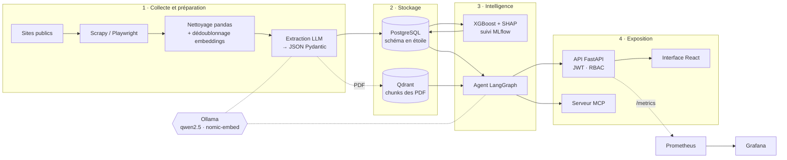
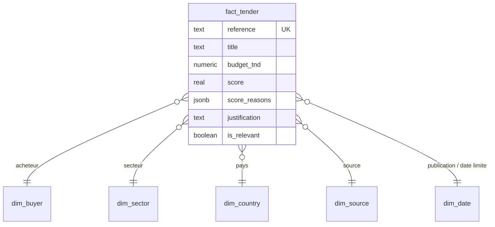
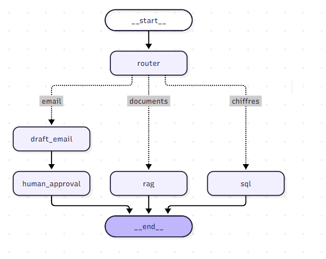
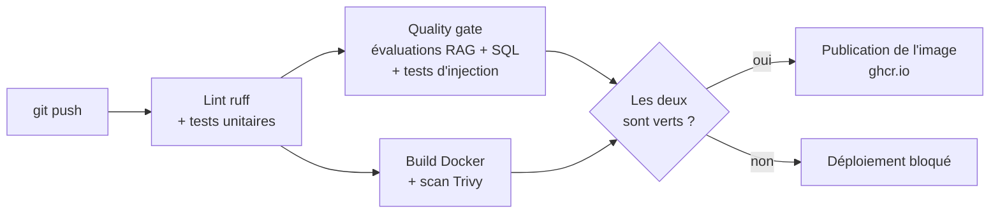

<div align="center">

# TenderIQ

### Copilote multi-agents de veille et d'analyse d'appels d'offres publics

**Détecter · Noter · Expliquer · Interroger · Se surveiller**

[](https://github.com/mounabensmida/tenderiq/actions/workflows/ci.yml)




</div>

---

## Sommaire

- [Le problème](#-le-problème)
- [Ce que fait TenderIQ](#-ce-que-fait-tenderiq)
- [Aperçu](#-aperçu)
- [Architecture](#-architecture)
- [L'agent LangGraph](#-lagent-langgraph)
- [Sous le capot](#-sous-le-capot)
- [Sécurité](#-sécurité)
- [Qualité, LLMOps et MLOps](#-qualité-llmops-et-mlops)
- [Stack technique](#-stack-technique)
- [Démarrage rapide](#-démarrage-rapide)
- [API](#-api)
- [Tests et évaluations](#-tests-et-évaluations)
- [Déploiement](#-déploiement)
- [Feuille de route](#-feuille-de-route)

---

## 🎯 Le problème

Chaque jour, des dizaines d'appels d'offres publics sont publiés en Tunisie et en Afrique, sur des sites différents, en
français ou en anglais, avec des cahiers des charges de plusieurs pages. Une PME n'a ni le temps de tout lire, ni le moyen
de savoir rapidement **lesquels valent une réponse**.

## 💡 Ce que fait TenderIQ

| | Fonction | Comment |
|---|---|---|
| 🕷️ | **Collecte** | Spider Scrapy générique + scraper Playwright pour les sites JavaScript |
| 🧹 | **Nettoyage et dédoublonnage** | pandas, puis détection des quasi-doublons par similarité d'embeddings |
| 🧾 | **Extraction structurée** | Un LLM transforme l'avis brut en fiche JSON **validée par Pydantic** |
| 🗄️ | **Entrepôt analytique** | PostgreSQL en **schéma en étoile** (1 table de faits, 5 dimensions) |
| 🎯 | **Score explicable** | XGBoost note chaque avis ; **SHAP** donne ses 3 raisons ; le LLM les reformule pour un commercial |
| 📄 | **Questions sur les documents** | **RAG hybride** (vecteurs + mots-clés, fusion RRF) sur Qdrant, **avec la page citée** |
| 📊 | **Questions chiffrées** | **Text-to-SQL** avec trois barrières de sécurité, en lecture seule |
| ✉️ | **Actions sous contrôle** | L'agent rédige un e-mail, puis **s'arrête** : seul un administrateur peut valider l'envoi |
| 🔌 | **Serveur MCP** | Les mêmes outils sont utilisables depuis n'importe quel client MCP (Claude Desktop, IDE…) |
| 🛡️ | **Garde-fou qualité** | La CI **bloque le déploiement** si la qualité du RAG ou du SQL passe sous un seuil |
| 📉 | **Détection de dérive** | Indice PSI sur les données entrantes → alerte et réentraînement, tracés dans MLflow |
| 📈 | **Observabilité** | Prometheus + Grafana (trafic, latence, erreurs, questions par route), Langfuse en option |

---

## 📸 Aperçu

<table>
<tr>
<td width="62%"></td>
<td width="38%"></td>
</tr>
<tr>
<td align="center"><sub>Connexion — comptes analyste et administrateur (RBAC)</sub></td>
<td align="center"><sub>Assistant — réponse chiffrée, résultats exacts de la base et requête SQL consultable</sub></td>
</tr>
</table>

Un clic sur une ligne du tableau ouvre l'**explication du score** : contribution de chaque facteur (valeurs SHAP) et
analyse rédigée par l'IA.

---

## 🏗️ Architecture



### Schéma en étoile



Une question comme « budget total par secteur et par pays » devient une simple jointure entre la table de faits et deux
dimensions.

---

## 🤖 L'agent LangGraph

<div align="center"></div>

| Nœud | Rôle |
|---|---|
| `router` | Le LLM classe la question en `documents`, `chiffres` ou `email` (sortie JSON, valeur sûre par défaut) |
| `rag` | Recherche hybride dans Qdrant, puis réponse **uniquement à partir des extraits**, avec citations `[1]` |
| `sql` | Génère un `SELECT`, le valide, l'exécute avec un utilisateur **lecture seule**, puis le résume |
| `draft_email` | Rédige un e-mail validé par Pydantic (adresse vérifiée) |
| `human_approval` | **`interrupt()`** : le graphe se met en pause. Il ne reprend qu'avec la décision d'un administrateur |

L'état de chaque conversation est conservé par un *checkpointer* : c'est ce qui permet de reprendre le graphe là où il
s'était arrêté, plusieurs minutes après, via la route `/approve`.

---

## 🔬 Sous le capot

<details>
<summary><b>Score explicable : XGBoost + SHAP + LLM</b></summary>

- **Features** : budget (log), délai pour répondre, secteur, pays, langue, mots-clés du titre.
- **Modèle** : `XGBClassifier`, entraîné sur les décisions passées de l'entreprise (« avons-nous répondu ? »).
- **Explication** : `shap.TreeExplainer` calcule la contribution de chaque feature pour **chaque** avis ; on garde les
  3 plus fortes, avec leur sens (augmente / diminue).
- **Justification** : le LLM reçoit ces 3 raisons et les reformule en 2 phrases, avec interdiction d'inventer un autre facteur.
- **Traçabilité** : paramètres, métriques (AUC, F1), modèle et graphique SHAP global sont enregistrés dans **MLflow**.

</details>

<details>
<summary><b>RAG hybride avec citation de la page</b></summary>

1. Les PDF des cahiers des charges sont découpés **page par page**, en morceaux de 800 caractères qui se chevauchent de 150.
2. Chaque morceau est transformé en vecteur (`nomic-embed-text`) et rangé dans Qdrant avec sa référence et son numéro de page.
3. Si la question cite une référence (`AO-2026-0001`), la recherche est **filtrée** sur ce document.
4. Deux classements, par le sens (vecteurs) et par les mots exacts, sont fusionnés par **Reciprocal Rank Fusion**.
5. Le prompt traite les extraits comme des **données** : une instruction cachée dans un PDF est ignorée.

</details>

<details>
<summary><b>Text-to-SQL sécurisé</b></summary>

Trois barrières indépendantes :

1. **Le prompt** : le LLM connaît le schéma et ne doit produire qu'un `SELECT`.
2. **Le validateur** : refuse tout ce qui ne commence pas par `SELECT`/`WITH`, les instructions multiples et les mots-clés
   dangereux (`DROP`, `DELETE`, `pg_sleep`…), puis ajoute un `LIMIT`.
3. **La base** : la requête s'exécute avec un rôle PostgreSQL **en lecture seule** (`default_transaction_read_only`),
   avec un délai maximal de 5 s.

Pour éviter les erreurs de calcul d'un petit modèle, le LLM n'a pas le droit de recalculer : il cite les valeurs, et
l'interface affiche les **lignes exactes** de la base sous la réponse.

</details>

<details>
<summary><b>Serveur MCP</b></summary>

`backend/mcp_server/server.py` publie 3 outils grâce au protocole **Model Context Protocol** :

| Outil | Description |
|---|---|
| `search_tender_documents` | Question sur le contenu des cahiers des charges (RAG) |
| `tender_statistics` | Question chiffrée (Text-to-SQL en lecture seule) |
| `top_tenders` | Les meilleures opportunités avec leur score |

Le fichier `.mcp.json` permet de les brancher directement dans un client compatible.

</details>

---

## 🛡️ Sécurité

| Menace | Contre-mesure |
|---|---|
| Accès sans autorisation | Jetons **JWT** signés (HS256) et expirants, mots de passe hachés avec **bcrypt** |
| Action dangereuse de l'agent | **Humain dans la boucle** + **RBAC** : seul le rôle `admin` peut valider un envoi (`403` sinon) |
| Injection SQL via le LLM | Validateur + rôle PostgreSQL **lecture seule** + délai maximal |
| Injection de prompt dans un document | Extraits marqués comme données ; un PDF piégé fait partie des tests |
| Fuite de secrets | `.env` hors de Git, secrets Kubernetes séparés, variable Terraform `sensitive` |
| Dépendances vulnérables | Scan **Trivy** de l'image Docker en CI (bloquant sur les failles critiques corrigeables) |
| Conteneur compromis | L'API tourne avec un utilisateur **non root** |
| Service en panne | Délai de connexion de 3 s vers PostgreSQL : erreur claire au lieu d'un blocage |

---

## 📈 Qualité, LLMOps et MLOps

### Le garde-fou en CI



| Métrique évaluée en CI | Seuil | Effet si non atteint |
|---|---|---|
| Score RAG (bonne information **et** bonne page citée) | ≥ 0,70 | ❌ déploiement bloqué |
| Exactitude du Text-to-SQL (même résultat que le SQL de référence) | ≥ 0,80 | ❌ déploiement bloqué |
| Tests d'injection de prompt | 100 % | ❌ déploiement bloqué |

### Dérive des données

`backend/ml/drift.py` compare chaque nouveau lot aux données d'entraînement avec l'indice **PSI** (Population Stability
Index), feature par feature. Au-delà de 0,25, une alerte est levée (code de sortie 1) et le réentraînement peut être
déclenché avec `--retrain`. Chaque contrôle est enregistré dans MLflow.

### Observabilité

| Outil | Ce qu'il montre |
|---|---|
| **Prometheus + Grafana** | Requêtes/s, latence p95, erreurs 5xx, questions par route (tableau versionné dans `infra/monitoring/grafana/dashboard.json`) |
| **MLflow** | Expériences d'entraînement, métriques, modèles, rapports de dérive |
| **Langfuse** *(optionnel)* | Trace de chaque question : routeur, outil, prompts, tokens, durée et coût |

---

## 🧰 Stack technique

| Domaine | Outils |
|---|---|
| **Collecte et données** | Scrapy · Playwright · pandas · PostgreSQL 16 · SQLAlchemy · schéma en étoile |
| **IA et ML** | Ollama (`qwen2.5:3b`, `nomic-embed-text`) · LangChain · Pydantic · XGBoost · SHAP · scikit-learn · MLflow |
| **RAG et agents** | Qdrant · recherche hybride RRF · LangGraph (`interrupt`, checkpointer) · Text-to-SQL · MCP |
| **Backend** | FastAPI · JWT (python-jose) · bcrypt · RBAC · pytest · ruff |
| **Frontend** | React 19 · Vite · CSS sur mesure (mode sombre automatique, responsive) |
| **DevOps** | Docker · Docker Compose · GitHub Actions · GHCR · Kubernetes (kind) · Terraform |
| **Observabilité et sécurité** | Prometheus · Grafana · Langfuse · Mailpit · Trivy |

---

## 🚀 Démarrage rapide

### Prérequis

Windows 10/11 · [Python 3.12](https://www.python.org/) · [Node.js ≥ 20.19](https://nodejs.org/) ·
[Docker Desktop](https://www.docker.com/products/docker-desktop/) · [Ollama](https://ollama.com/download) · Git

### En un double-clic

```bash
git clone https://github.com/mounabensmida/tenderiq.git
```

Puis **double-cliquez sur `start.bat`**. Le script :

1. crée l'environnement Python et installe les dépendances (premier lancement uniquement) ;
2. crée `.env` à partir de `.env.example` s'il n'existe pas ;
3. démarre Docker Desktop et Ollama s'ils sont arrêtés ;
4. lance PostgreSQL, Qdrant, Mailpit, Prometheus, Grafana et MLflow ;
5. prépare **seulement ce qui manque** : modèles Ollama, données, entraînement, scores, index des PDF ;
6. lance l'API et l'interface, puis ouvre le navigateur.

Il peut être relancé sans risque. `stop.bat` arrête tout en conservant les données.

> Changez les mots de passe de `.env` avant toute utilisation réelle.

### Services

| Service | Adresse | Identifiants |
|---|---|---|
| **Interface** | http://localhost:5173 | `analyste` / `analyste123` · `admin` / `admin123` |
| API (Swagger) | http://localhost:8000/docs | mêmes comptes |
| Grafana | http://localhost:3001 | `admin` / `admin` |
| Prometheus | http://localhost:9090 | — |
| MLflow | http://localhost:5000 | — |
| Qdrant | http://localhost:6333/dashboard | — |
| Mailpit (e-mails envoyés) | http://localhost:8025 | — |

<details>
<summary><b>Lancement manuel, étape par étape</b></summary>

```bash
python -m venv .venv
.venv\Scripts\activate
pip install -r backend/requirements.txt
copy .env.example .env

docker compose up -d postgres qdrant mailpit prometheus grafana
ollama pull qwen2.5:3b
ollama pull nomic-embed-text

python -m backend.scraper.generate_samples        # données de démonstration + PDF
python -m backend.pipeline.run --no-llm           # nettoyage, dédoublonnage, chargement
python -m backend.ml.train                        # entraînement + MLflow
python -m backend.ml.score_all --limit 10         # scores, raisons SHAP, justifications
python -m backend.rag.ingest                      # indexation des PDF dans Qdrant

uvicorn backend.app.main:app --reload --reload-dir backend
cd frontend && npm install && npm run dev
```

</details>

---

## 🔌 API

| Méthode | Route | Accès | Description |
|---|---|---|---|
| `POST` | `/auth/token` | public | Connexion, renvoie un jeton JWT |
| `GET` | `/tenders` | connecté | Opportunités triées par score, avec raisons SHAP et justification |
| `GET` | `/stats` | connecté | Indicateurs du tableau de bord et répartition par secteur |
| `POST` | `/ask` | connecté | Question à l'agent : réponse, route, sources, SQL et lignes de résultat |
| `POST` | `/approve` | **admin** | Valide ou refuse l'e-mail en attente |
| `GET` | `/metrics` | public | Métriques Prometheus |
| `GET` | `/health` | public | État de l'API |

Documentation interactive : http://localhost:8000/docs

---

## 🧪 Tests et évaluations

```bash
pytest -m "not integration"     # tests unitaires : modèles, garde-fou SQL, API, pipeline
python -m evals.run_evals       # évaluation RAG + Text-to-SQL (code 1 sous le seuil)
python -m evals.scenarios       # 8 scénarios de bout en bout sur l'application lancée
```

`evals/scenarios.py` joue le parcours d'un vrai utilisateur via l'API, puis vérifie le résultat dans la base, dans Qdrant
ou dans la boîte mail de test :

| # | Scénario | Ce qui est vérifié |
|---|---|---|
| 1 | Connexion et droits | Mauvais mot de passe, absence de jeton et jeton falsifié → `401` |
| 2 | Tableau de bord | Indicateurs identiques à la base, tri par score, 3 raisons SHAP par avis |
| 3 | Questions sur les documents | Bonne information **et** bonne page citée |
| 4 | Questions chiffrées | Résultat du SQL généré identique à la vérité de la base |
| 5 | E-mail | Pause de l'agent, rien n'est envoyé, `403` pour l'analyste, envoi réel après validation admin |
| 6 | Attaques | Injection cachée dans un PDF ignorée, « supprime tout » sans effet, `DELETE` refusé par la base |
| 7 | Observabilité | Questions comptées par route, API collectée par Prometheus |
| 8 | Dérive | Alerte sur un lot dont la distribution a changé |

---

## ☁️ Déploiement

| Cible | Fichiers | Commande |
|---|---|---|
| **Docker** | `infra/docker/backend.Dockerfile` | `docker compose up -d --build api` |
| **Kubernetes (kind)** | `infra/k8s/` : Deployments, Services, ConfigMap, Secret | `kind create cluster --name tenderiq` puis `kubectl apply -f infra/k8s/` |
| **Terraform** | `infra/terraform/main.tf` : réseau et conteneurs Docker déclarés en code | `terraform init` · `plan` · `apply` |
| **Registre** | Image publiée sur GHCR par la CI, seulement si tous les contrôles sont verts | automatique sur `main` |

---

## 🗺️ Feuille de route

- [ ] Brancher les spiders sur des sources réelles (TUNEPS, Banque africaine de développement)
- [ ] Checkpointer PostgreSQL pour que les validations en attente survivent à un redémarrage
- [ ] Interface en arabe (le modèle répond déjà dans la langue de la question)
- [ ] Langfuse auto-hébergé dans Docker Compose
- [ ] Tableau de bord métier Superset sur le schéma en étoile
- [ ] Alertes e-mail quotidiennes sur les nouvelles opportunités à fort score

---

## 🎓 Compétences mises en œuvre

**Data engineering** (scraping, nettoyage, modélisation en étoile) · **Machine learning explicable** (XGBoost, SHAP) ·
**IA générative** (extraction structurée, RAG hybride, Text-to-SQL, agents LangGraph, MCP) · **MLOps / LLMOps**
(MLflow, dérive, évaluations bloquantes en CI) · **Génie logiciel** (FastAPI, React, tests, sécurité) ·
**DevOps** (Docker, CI/CD, Kubernetes, Terraform, observabilité).

---

<div align="center">

Projet réalisé par **[@mounabensmida](https://github.com/mounabensmida)** · Licence MIT

</div>
